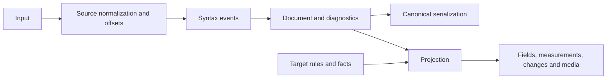

# Architecture

`gsx-core` owns the `gsx/1` model and all format rules. Bindings translate inputs, types and errors; callers own credentials, uploads, account resolution and publication. The core has no I/O or `unsafe` code.

## Pipeline

The parser produces one document for serialization and projection; bindings expose these operations through a shared JSON writer.



| Core module | Responsibility |
| --- | --- |
| `source`, `syntax` | Normalization, source positions, tokenizer and complexity budgets |
| `document` | Node tree, markers, validation and diagnostics |
| `serialize` | Canonical text and source fallback |
| `measure` | Unicode segmentation, length units and field limits |
| `project` | Field derivation, fitting, threads and media plans |
| `forms` | Plain text, entities, Markdown, HTML and blocks |
| `targets` | Rules, form configuration and limits per target |
| `wire` | JSON encoding shared by all bindings |

Module paths are relative to [`crates/gsx-core/src`](../crates/gsx-core/src). Contract details live in [decisions/](decisions/readme.md).

The tokenizer and document model do not depend on projection or bindings. Projection depends on the document and measurement layers; forms implement its renderer interface, and targets select forms and rules. Renderer callbacks keep platform modules out of the projection engine. Serialization depends on the document and reparses through the same grammar. [Parser ownership](decisions/parser.md) explains the event-stream boundary.

Sorts in the core outside the tokenizer's edit map go through `order::sort_by_key`: one unstable sort of `(u64 key, u32 index)` pairs, stable through the index, so the Wasm build does not carry a sort instance per element type. Keys pack two offsets into one `u64` with `order::pair`, which relies on input and output offsets staying below 2³², as the [input limits](decisions/conformance.md#limits) guarantee. The same bound lets tokenizer points store line, column and byte offset as `u32`, which keeps events compact on 64-bit hosts; `document::parse` rejects oversized input before tokenizing.

A target's rule table drives rendering outcomes, capabilities and its manifest. Keep behavior in that table and shared form configuration so declarations cannot drift from rendering. Bindings share the Rust wire writer; byte-for-byte parity is enforced by [consumer replay](../AGENTS.md#replay-and-performance).

## Bindings

```text
gsx-core
├── gsx-wasm -> gsx.wasm + gsx.js -> @meritt/gsx-wasm
└── gsx-ffi
    ├── GSXFFI.xcframework -> GSX (Swift)
    └── libgsx -> gsx (Python, ctypes)
```

[`gsx-ffi`](../crates/gsx-ffi) owns the C ABI and its unsafe boundary. Package contracts are in [bindings.md](decisions/bindings.md).

## Targets

Names follow `<platform>-<form>[-<variant>]`, using the current lowercase platform name (`x`, not `twitter`). A variant distinguishes targets of the same platform and form. `targets()` returns the configured targets, capabilities and manifests; these describe this release's behavior.

| Form | Targets | Rule table |
| --- | --- | --- |
| Plain | `x-plain`, `mastodon-plain`, `linkedin-plain`, `facebook-plain`, `instagram-plain`, `vk-plain`, `youtube-plain`, `tiktok-plain`, `slack-plain` | [plain.rs](../crates/gsx-core/src/targets/plain.rs) |
| Entities | `telegram-entities`, `bluesky-entities`, `threads-entities` | [entities.rs](../crates/gsx-core/src/targets/entities.rs) |
| HTML | `telegram-html`, `telegram-html-rich`, `max-html` | [html.rs](../crates/gsx-core/src/targets/html.rs) |
| Markdown | `discord-markdown`, `slack-markdown` | [markdown.rs](../crates/gsx-core/src/targets/markdown.rs) |
| Blocks | `discord-blocks`, `slack-blocks` | [blocks.rs](../crates/gsx-core/src/targets/blocks.rs) |

`telegram-entities` represents MTProto story captions; `telegram-html` represents Bot API messages and captions with HTML parse mode; `telegram-html-rich` represents rich-message HTML. `discord-blocks` represents Components V2 and `slack-blocks` represents Block Kit. `slack-plain` represents a file upload comment, and `linkedin-plain` uses Little Text Format escaping. `youtube-plain` produces a title and description; TikTok photo posts and VK videos also have derived title fields.
